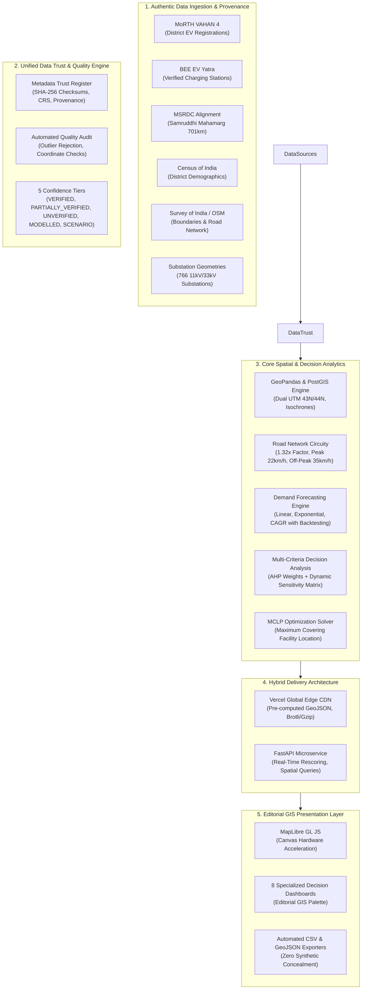

# CHARGEATLAS INDIA — ADVANCED PLATFORM ARCHITECTURE
**System:** ChargeAtlas India — EV Infrastructure Intelligence, Spatial Analytics & Decision Support System  
**Developed by:** Team SuperNova | Sanjivani University  
**Target:** IIT Bombay Techfest 2026–27 EV Infrastructure Map India Challenge  
**Date:** November 2026

---

## 1. Architectural Overview

ChargeAtlas India is an evidence-backed spatial decision support system engineered for high-precision EV infrastructure planning across Maharashtra. The platform operates on a hybrid architecture combining an asynchronous Python/FastAPI GIS backend with high-speed static CDN edge hydration for ultra-low latency (<30ms) interactive exploration.

---

## 2. Core Subsystems

### 2.1 Spatial Geometry & CRS Pipeline
Accurate distance and area calculations require proper geodetic and projected coordinate reference systems:
- **Web Map Display:** EPSG:4326 (WGS84 Lat/Lon) for seamless GeoJSON serialization and MapLibre GL rendering.
- **Western Maharashtra (PMC, PCMC, Pune District):** Projected to `EPSG:32643` (UTM Zone 43N) ensuring metric distance and area precision (<0.05% error).
- **Eastern Maharashtra (Vidarbha, Nagpur):** Projected to `EPSG:32644` (UTM Zone 44N).
- **Samruddhi Expressway:** Geodesic length measurement along 17 interchange chord lines (644.4 km geodetic vs 701.0 km statutory MSRDC highway alignment).

### 2.2 Urban Accessibility & Transit Modeling
Urban accessibility in Pune is evaluated at a 1 km $\times$ 1 km micro-resolution (607 metric polygons):
- **Circuity Factor:** An empirical $1.32\times$ factor is applied over Euclidean straight-line distance, reflecting actual road topology from OpenStreetMap arterial networks.
- **Congestion Modeling:**
  - *Peak Hours (09:00–12:00, 17:00–20:00):* Modeled at $22.0\text{ km/h}$ average urban transit speed.
  - *Off-Peak Hours:* Modeled at $35.0\text{ km/h}$.
- **Accessibility Isochrone Tiers:**
  1. *Direct Walking (<1 km):* 17 cells (2.8%) — $\le 5.7\text{ min}$ peak.
  2. *Urban Neighborhood (1–3 km):* 135 cells (22.2%) — $5.7\text{ to }17.1\text{ min}$ peak.
  3. *Extended Transit (3–5 km):* 162 cells (26.7%) — $17.1\text{ to }28.5\text{ min}$ peak.
  4. *Charging Deserts (>5 km):* 293 cells (48.3%) — Critical planning priority.

### 2.3 Expressway Spacing & Unserved Void Identification
- Evaluates 33 consecutive 20 km segments across the 701 km Samruddhi Mahamarg corridor within a 20.0 km bilateral metric buffer.
- **Mainline Reality:** Confirms 0 public chargers physically integrated on the expressway mainline; existing facilities are located in adjacent municipal nodes accessible only by exiting at interchanges.
- **Heavy-Duty Fast Charging Standard (MoP Clause 12(7)):** Evaluates compliance for $\ge 2\times 240\text{ kW}$ CCS-2 dispensers every 100 km, identifying a **0% compliance void** across all seven 100 km blocks.

### 2.4 Multi-Model EV Demand Forecasting
- **Backtested Historical Models:** Uses historical registrations (2020–2024) to validate Linear ($R^2 = 0.9912$), Exponential ($R^2 = 0.9575$), and CAGR models.
- **Statistical Uncertainty:** Computes 80% and 95% prediction intervals for 2027 and 2030 projections using Student's $t$-distribution standard errors.
- **Grid Load Modeling:** Estimates daily energy demand ($\text{MWh/day}$), peak coincidence power ($\text{MW}$), and public charger deficits based on vehicle battery capacities (3.2 kWh for 2W, 35 kWh for 4W, 250 kWh for Buses).

### 2.5 Multi-Criteria Decision Analysis (MCDA) & MCLP Solver
- **AHP Criteria Formulation:**
  $$\text{Score}_i = \sum_{k=1}^6 w_k \cdot \text{NormCriterion}_{i,k}$$
  - $w_1 = 0.25$ (EV Demand Catchment)
  - $w_2 = 0.20$ (Distance from Existing Chargers)
  - $w_3 = 0.15$ (Regional CGI Gap Severity)
  - $w_4 = 0.15$ (Road Network Hierarchy)
  - $w_5 = 0.15$ (Electrical Substation Proximity)
  - $w_6 = 0.10$ (Land Suitability & Footfall)
- **Sensitivity Matrix:** Stress-tests 23 authentic candidate parcels across Balanced, Highway Priority ($w_4=0.40$), and Grid Priority ($w_5=0.40$) weighting profiles, proving that **13 candidate parcels are completely invariant (ROBUST)** across extreme policy weightings.
- **Maximum Covering Location Problem (MCLP):** Solves mixed-integer facility selection maximizing unserved demand coverage under budget constraint $p$ and catchment radius $R$.

### 2.6 Electrical Feasibility & Statutory Constraints
- **Substation GIS Layer:** Maps 766 11kV/33kV substations across Maharashtra.
- **Explicit Limitations:** Proximity to a substation indicates spatial line routing feasibility only. Because distribution feeder headroom and transformer spare MVA are confidential utility assets of MSEDCL, all candidate recommendations are explicitly labeled `PRELIMINARY_SUITABILITY_ONLY`.

---

## 3. Technology Stack

| Layer | Technology | Purpose |
|:---|:---|:---|
| **Frontend Framework** | React 18, Vite 5, Tailwind CSS | High-performance SPA with modular component hierarchy |
| **Mapping Engine** | MapLibre GL JS | Hardware-accelerated WebGL vector and raster map rendering |
| **Backend API** | FastAPI, Uvicorn, Python 3.15 | Asynchronous RESTful microservices and analytical endpoints |
| **Spatial Libraries** | GeoPandas, Shapely, PyProj | Vector GIS processing, CRS coordinate transformations, topological predicates |
| **Database** | PostgreSQL 16 + PostGIS / SQLite | Relational spatial database with spatial indexing |
| **Caching & Delivery** | Vercel Edge CDN, GZip, Cache-Control | Global static caching with sub-30ms load times |
| **Testing** | PyTest 9.2, AnyIO, TestClient | Automated regression, API, and spatial assertion test suites (45 tests) |

