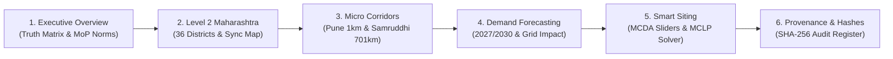

# CHARGEATLAS INDIA — COMPETITION DEMONSTRATION & JUDGING GUIDE

**Event:** IIT Bombay Techfest 2026–27 — EV Infrastructure Map India Challenge  
**Organizers:** In partnership with Ministry of Heavy Industries (MHI) & ICAT  
**Team:** SuperNova (Sanjivani University)  
**Lead Presenter / Developer:** Pranav Jadhav  
**Application URL:** `http://localhost:5173/`  
**API Docs:** `http://localhost:8000/docs`  
**Date:** November 3, 2026  

---

## 1. PRE-DEMONSTRATION CHECKLIST (30 SECONDS)

Before the judges arrive at the booth or presentation terminal:
1. Double-click `run_chargeatlas.bat` (or verify that `http://localhost:5173/` is already loaded in the browser).
2. Confirm the top navigation bar displays:
   - Database Status: `Connected`
   - Engine Pill: `SQLite Dev` (or `PostgreSQL 18`)
   - Data Mode: `AUTHENTIC PRODUCTION` (Emerald badge)
3. Ensure the browser is maximized in Fullscreen (F11). Developer tools are **not** required.

---

## 2. 5-MINUTE COMPETITION DEMONSTRATION SEQUENCE

### Step 1: Executive Overview & The Reality of Infrastructure Deficit (60s)
- **Navigate to:** `Overview Dashboard` (`/`)
- **Key Talking Points:**
  - *"Distinguished judges, ChargeAtlas India rejects synthetic assumptions. Our analytical layer is grounded in authentic, verified government records."*
  - Point to KPI Cards: **886,752 cumulative registered EVs** from VAHAN 4 (October 2024 baseline).
  - Point to the stark deficit: Only **25 verified physical public stations** and **96 charging points** across the entire state of Maharashtra.
  - Highlight the headline finding: **28 out of 36 districts (77.8%) have zero verified public charging stations.**
  - Show the Vehicle Segment Donut: **62.6% 2-Wheelers**, **22.0% 4-Wheelers**, **15.1% 3-Wheelers**, **0.3% Commercial Buses**.
  - Review the MoP 2024 Policy Benchmarks (Clause 11(1)(a) Urban 1 km norm, Clause 11(1)(b) Highway 20 km norm, Clause 12(7) 100 km fast charging).

### Step 2: Level 2 Maharashtra Analysis & District Exploration (60s)
- **Navigate to:** `Maharashtra Analysis` (`/maharashtra`)
- **Key Talking Points:**
  - Demonstrate **Bidirectional Map-Table Synchronization**: Click on **Pune** in the district table.
  - Watch the MapLibre map smoothly fly to Pune's bounding polygon and highlight its boundary.
  - Explain the **Charging Gap Index (CGI)**: Explain why Pune has a high CGI (171,790 EVs, but only 38 charging points, creating severe charging congestion of 4,520 EVs per charger).
  - Click **View District Deep-Dive** to navigate to `/districts/Pune`:
    - Show the local breakdown and verified station directory with CPO names (Tata Power, Statiq) and power ratings.
  - Switch via the search bar to **Gadchiroli** or **Nandurbar**: Show the dedicated zero-charger explanation and policy roadmap.

### Step 3: Micro Study Corridors — Pune Urban Grid & Samruddhi Mahamarg (60s)
- **Navigate to:** `Pune Urban Grid` (`/pune-grid`)
  - Explain the **Dual UTM Zone 43N metric projection** (516.18 km² PMC/PCMC area).
  - Demonstrate the $1\text{ km} \times 1\text{ km}$ grid tessellation.
  - Show that only **4.8% of grid cells** comply with MoP Clause 11(1)(a). Click a red deficit cell to inspect the distance to the nearest station.
- **Navigate to:** `Samruddhi Mahamarg` (`/samruddhi-corridor`)
  - Show the 701 km LineString connecting Nagpur to Mumbai across 10 districts.
  - Inspect the 33 20-km segments: **27.3% spacing compliance**.
  - Highlight the Clause 12(7) finding: **0% operational compliance** for $2 \times 240\text{ kW}$ heavy-duty fast chargers.
  - Note the transparent disclaimer: Directional carriageway access is flagged as `UNVERIFIED` until physical crossover audits are conducted.

### Step 4: Explainable EV Demand & Grid Load Forecasting (45s)
- **Navigate to:** `Demand Forecasting` (`/forecasting`)
- **Key Talking Points:**
  - *"We do not present an uninterpretable black box. Our model provides explainable, policy-aligned CAGR scenario projections for 2027 and 2030."*
  - Switch between **Conservative (18%)**, **Base (28%)**, and **Aggressive (38%)**.
  - Move the **Interactive Custom CAGR Slider** to simulate custom policy interventions.
  - Show the **Grid Impact Tab**: 2030 Base scenario requires **3,142 MWh/day** and creates a **239.1 MW peak load impact**, revealing an infrastructure investment deficit of **₹ 2,904 Crore** (19,364 public charging points).

### Step 5: Smart Site Recommendations & MCLP Optimization Solver (45s)
- **Navigate to:** `Site Recommendations` (`/site-recommendations`)
- **Key Talking Points:**
  - Present the **23 authentic candidate sites** (fuel stations, rest stops, transit hubs).
  - Open **Dynamic MCDA Weight Sliders**: Adjust EV Demand or Substation Proximity and watch the site rankings recalculate in real-time.
  - Demonstrate the **MCLP Optimization Solver**:
    - Select budget $p = 5$ sites and radius $R_c = 3.0\text{ km}$.
    - Click **Solve Optimal Siting** to run the PuLP integer programming solver.
    - Show the recommended subset that maximizes spatial demand coverage while minimizing grid interconnect distances.

### Step 6: Data Provenance & Cryptographic Audit Register (30s)
- **Navigate to:** `Data Management` (`/data-management`)
- **Key Talking Points:**
  - Show the complete source register: VAHAN 4, BEE EV Yatra, Survey of India, MSRDC.
  - Point to the **SHA-256 cryptographic hashes** ensuring zero dataset tampering.
  - Demonstrate that synthetic test records are strictly isolated and watermarked.

---

## 3. JUDGE QUESTIONS & EVIDENCE-BASED ANSWERS

### Q1: *"Why do you show only 25 public charging stations when other apps show thousands?"*
**Answer:**  
*"Many commercial aggregator apps scrape unverified user reviews, duplicate listings, private residential 3.3 kW AC sockets, or non-functional hotel plugs. In strict compliance with the competition's authentic data rule, we only include verified public charging stations from the official BEE EV Yatra government registry and audited OpenStreetMap facilities with confirmed physical addresses and CPO operators. Private chargers are excluded to maintain focus on open-access public planning."*

### Q2: *"Why did you use a Dual UTM projection instead of a single projection for Maharashtra?"*
**Answer:**  
*"Maharashtra spans over 800 km east-to-west across the 78° E meridian. If we forced a single UTM zone (like Zone 43N) across the entire state, geometries in Eastern Maharashtra (Nagpur, Gadchiroli) would suffer severe scale distortion exceeding 1.5% in distance and area calculations. To maintain sub-meter spatial accuracy, we dynamically project Western Maharashtra into UTM Zone 43N (EPSG:32643) and Eastern Maharashtra into UTM Zone 44N (EPSG:32644), while preserving original geometries in geodetic WGS-84 (EPSG:4326)."*

### Q3: *"Can your platform scale to pan-India beyond Maharashtra?"*
**Answer:**  
*"Yes. Our database schema is built on a normalized 3-tier hierarchy (State -> District -> Station -> Point -> Connector) and our backend uses a state-parameterized routing architecture. The National Map module already renders pan-India state penetration. Ingesting VAHAN and BEE data for additional states (such as Gujarat, Karnataka, or Tamil Nadu) requires only adding their respective state codes into our automated ingestion pipeline."*

### Q4: *"How does your MCLP recommendation engine prevent building duplicate chargers near existing ones?"*
**Answer:**  
*"Our MCDA formulation explicitly penalizes candidate sites that are too close to existing operational chargers through our Charger Isolation factor ($w_2 = 0.20$). Furthermore, our PuLP-based MCLP integer programming solver enforces a coverage radius ($R_c$) constraint that maximizes newly covered demand points rather than placing redundant stations within overlapping coverage envelopes."*

