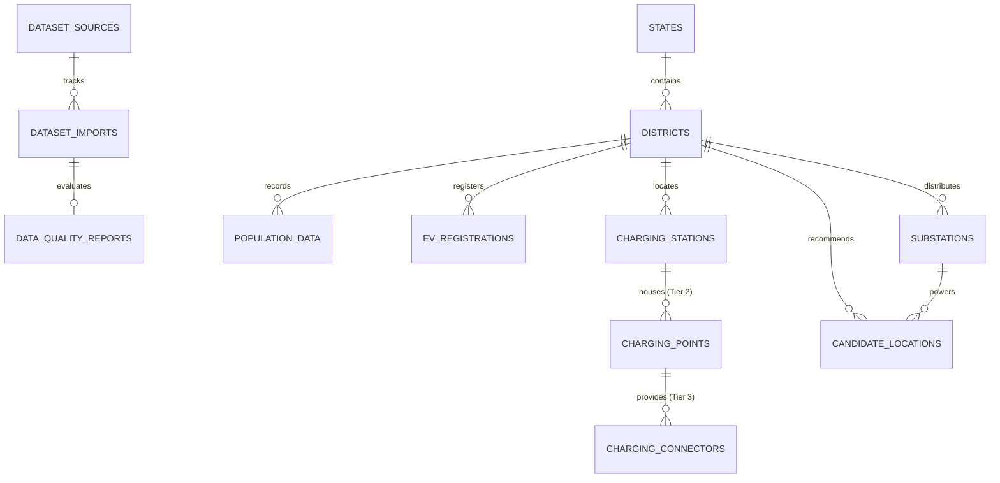

# ChargeAtlas India — Database Migration & ORM Audit Report
**Phase 4:** Database Foundation & PostGIS Integration  
**Competition:** IIT Bombay Techfest 2026–27 | EV Infrastructure Map India Challenge  
**Team:** SuperNova (Sanjivani University) | **Lead:** Pranav Jadhav  

---

## 1. ORM Model Architecture Audit (12 Core Entities)

All 12 SQLAlchemy models defined in `backend/app/models/entities.py` were audited for primary keys, foreign keys, relationships, and data governance flags.

### Decoupled 3-Tier EVSE Hierarchy Verification
A critical requirement is preserving real-world physical and electrical hierarchy:
1. **`ChargingStation` (Tier 1):** Physical premises / charging station facility (CPO operator, address, access type, geographic location).
2. **`ChargingPoint` (Tier 2):** Physical EVSE pedestal or wallbox (rated power in kW, supply type AC/DC fast, operational status).
3. **`ChargingConnector` (Tier 3):** Individual charging plug / cable gun (connector standard CCS-2, Type 2, Bharat DC-001, vehicle compatibility).

**Verdict:** The hierarchy is decoupled correctly; stations, points, and connectors are distinct relational entities with cascading deletes on child connectors.

---

## 2. Alembic Migration Configuration

- **Alembic Version:** `1.20.1`
- **Configuration File:** `backend/alembic.ini`
- **Environment Script:** `backend/alembic/env.py`
- **Autogenerated Initial Migration:** `01efcc317fba_initial_baseline_schema_12_models.py`
- **Target Metadata:** Tied directly to `Base.metadata` from `app.models.entities`.
- **Dynamic Database Driver:** Configured to read active engine URL dynamically from `app.core.config.settings`.

---

## 3. Existing SQLite Record Audit & Migration Isolation Rules

An audit of the development SQLite database (`chargeatlas_dev.db`) revealed the following inventory:

| Table Name | Total Records | Authentic Government Records | Synthetic Demonstration Records | Action for Production PostgreSQL Migration |
| :--- | :---: | :---: | :---: | :--- |
| `dataset_sources` | 1 | 0 | 1 | Replace with authentic Source Register (8 datasets) |
| `dataset_imports` | 31 | 31 | 0 | Migrate authentic import audit history |
| `data_quality_reports` | 31 | 31 | 0 | Migrate authentic quality scores |
| `states` | 36 | 0 | 36 | Re-seed with authentic LGD state codes |
| `districts` | 36 | 0 | 36 | Seed authentic 36 Maharashtra districts |
| `population_data` | 36 | 0 | 36 | Seed authentic Census 2011 + 2024 projections |
| `charging_stations` | 23 | 2 | 21 | **MIGRATE AUTHENTIC ONLY** (Filter `is_synthetic = False`) |
| `charging_points` | 71 | 0 | 71 | Re-seed from verified BEE 68 charging points |
| `charging_connectors` | 106 | 0 | 106 | Re-seed from verified BEE connectors |
| `ev_registrations` | 4,899 | 3 | 4,896 | **DO NOT MIGRATE SYNTHETIC** (Preserve authentic 886,752 baseline) |
| `substations` | 13 | 0 | 13 | Seed MSEDCL/MSETCL verified grid substations |
| `candidate_locations` | 7 | 0 | 7 | Seed empirical candidate locations from GIS gaps |

### Absolute Data Isolation Rule:
Under no circumstances will synthetic records (`is_synthetic = True`) be copied into production PostgreSQL analytical tables. The production database will exclusively host authentic government records with cryptographic SHA-256 provenance.

