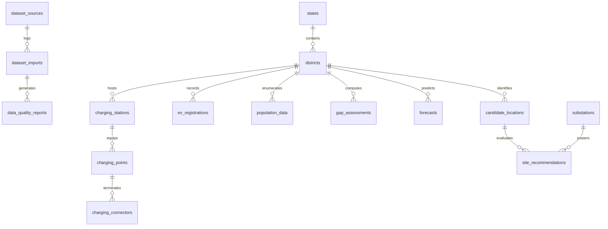

# ChargeAtlas India — Relational & PostGIS Database Schema

## 1. Database Architecture & Design Principles
The ChargeAtlas database schema is built on **PostgreSQL 18** with the **PostGIS 3.x** spatial extension. All geometries use standard spatial reference systems:
- **`EPSG:4326` (WGS 84)** for spatial storage and GeoJSON export.
- **`EPSG:3857` (Web Mercator)** or local UTM projections (`EPSG:32643` for Western India) for metric distance and buffer calculations.

---

## 2. Entity-Relationship Overview

---

## 3. Detailed Table Definitions

### 3.1 Metadata & Data Governance

#### `dataset_sources`
Tracks upstream data provenance, licensing, and access credentials.
- `id` (VARCHAR(64), PK): Unique source key (e.g., `vahan_dashboard`, `openchargemap`, `bee_evyatra`, `osm_india`, `synthetic_demo`).
- `name` (VARCHAR(255)): Official source title.
- `organization` (VARCHAR(255)): Originating agency (e.g., MoRTH, BEE, OSM Foundation).
- `source_url` (TEXT): Public URL or API endpoint.
- `license_type` (VARCHAR(100)): Open Data, Government Open Data (GODL-India), ODbL, etc.
- `update_frequency` (VARCHAR(50)): Monthly, Realtime, Static.
- `is_synthetic` (BOOLEAN): Defaults to `FALSE`. Set to `TRUE` for demonstration mock data.
- `created_at` (TIMESTAMPTZ): Record creation timestamp.

#### `dataset_imports`
Audit log of every batch file upload, cleaning run, and database sync.
- `id` (UUID, PK): Auto-generated transaction ID.
- `source_id` (VARCHAR(64), FK -> `dataset_sources.id`): Originating source.
- `file_name` (VARCHAR(255)): Original uploaded file name.
- `file_format` (VARCHAR(20)): `csv`, `geojson`, `xlsx`, `shapefile`.
- `total_rows_read` (INTEGER): Raw row count.
- `valid_rows_imported` (INTEGER): Rows passing schema and spatial validation.
- `rejected_rows_count` (INTEGER): Invalid or duplicate rows rejected.
- `status` (VARCHAR(30)): `UPLOADED`, `PROCESSING`, `VALIDATED`, `IMPORTED`, `NEEDS_REVIEW`, `FAILED`.
- `error_summary` (JSONB): Structured log of validation issues.
- `imported_at` (TIMESTAMPTZ): Completion timestamp.

#### `data_quality_reports`
Automated assessment scoring data integrity.
- `id` (UUID, PK)
- `import_id` (UUID, FK -> `dataset_imports.id`)
- `coordinate_validity_score` (NUMERIC(5,2)): Percentage with valid lat/long within India bounds (0.00 - 100.00).
- `duplicate_rate` (NUMERIC(5,2)): Percentage duplicates detected and merged.
- `completeness_score` (NUMERIC(5,2)): Percentage without critical NULL values.
- `overall_confidence_score` (NUMERIC(5,2)): Weighted aggregate data quality score.
- `generated_at` (TIMESTAMPTZ)

---

### 3.2 Geographical & Administrative Units

#### `states`
- `state_code` (VARCHAR(10), PK): ISO / LGD state code (e.g., `IN-MH` for Maharashtra).
- `name` (VARCHAR(100)): State name.
- `lgd_code` (INTEGER, UNIQUE): Local Government Directory code.
- `geom` (GEOMETRY(MultiPolygon, 4326)): State boundary polygon.

#### `districts`
- `district_code` (VARCHAR(20), PK): Composite or LGD code (e.g., `MH-PUN` for Pune).
- `state_code` (VARCHAR(10), FK -> `states.state_code`).
- `name` (VARCHAR(100)): District name.
- `lgd_code` (INTEGER, UNIQUE): LGD official district code.
- `area_sqkm` (NUMERIC(10,2)): Total geographical area in km².
- `geom` (GEOMETRY(MultiPolygon, 4326)): District boundary polygon.

---

### 3.3 Charging Infrastructure (3-Tier Decoupled Architecture)

#### `charging_stations` (Tier 1: Location/Site)
- `id` (VARCHAR(64), PK): Unique station identifier (UUID or source-prefixed code).
- `name` (VARCHAR(255)): Name of the station / premises.
- `operator` (VARCHAR(150)): CPO name (e.g., Tata Power EZ Charge, Statiq, Jio-bp, Kazam).
- `address` (TEXT): Full postal address.
- `district_code` (VARCHAR(20), FK -> `districts.district_code`).
- `location` (GEOMETRY(Point, 4326), NOT NULL): Exact spatial point (Longitude, Latitude).
- `latitude` (NUMERIC(10,7)): Explicit latitude coordinate.
- `longitude` (NUMERIC(10,7)): Explicit longitude coordinate.
- `access_type` (VARCHAR(50)): `PUBLIC`, `SEMI_PUBLIC`, `RESTRICTED`.
- `status` (VARCHAR(50)): `OPERATIONAL`, `OFFLINE`, `UNDER_MAINTENANCE`, `PLANNED`.
- `amenities` (JSONB): Available amenities (e.g., `["washroom", "food_court", "wifi"]`).
- `confidence_score` (NUMERIC(5,2)): 0.00 - 100.00 based on source verification count.
- `is_synthetic` (BOOLEAN): Explicit demonstration flag.
- `source_id` (VARCHAR(64), FK -> `dataset_sources.id`).
- `last_verified_at` (TIMESTAMPTZ): Last ground-truth or API refresh date.

#### `charging_points` (Tier 2: Physical EVSE / Pedestals)
- `id` (VARCHAR(64), PK): Unique EVSE box ID.
- `station_id` (VARCHAR(64), FK -> `charging_stations.id`, ON DELETE CASCADE).
- `evse_model` (VARCHAR(150)): Hardware model/brand.
- `rated_power_kw` (NUMERIC(6,2)): Maximum simultaneous power output in kW.
- `supply_type` (VARCHAR(20)): `AC_SINGLE_PHASE`, `AC_THREE_PHASE`, `DC_FAST`.
- `operational_status` (VARCHAR(50)): `AVAILABLE`, `CHARGING`, `FAULTED`, `OFFLINE`.

#### `charging_connectors` (Tier 3: Individual Guns / Plugs)
- `id` (VARCHAR(64), PK): Unique gun identifier.
- `point_id` (VARCHAR(64), FK -> `charging_points.id`, ON DELETE CASCADE).
- `connector_type` (VARCHAR(50)): `CCS_2`, `TYPE_2_AC`, `BHARAT_AC_001`, `BHARAT_DC_001`, `CHADEMO`, `GB_T`.
- `max_current_amps` (NUMERIC(6,2)): Current rating.
- `max_voltage_volts` (NUMERIC(6,2)): Voltage rating.
- `power_kw` (NUMERIC(6,2)): Individual port output capacity.

---

### 3.4 EV Population, Demand & Power Grid

#### `ev_registrations`
- `id` (UUID, PK)
- `district_code` (VARCHAR(20), FK -> `districts.district_code`)
- `year` (INTEGER): Calendar or financial year.
- `month` (INTEGER): 1 to 12.
- `vehicle_category` (VARCHAR(20)): `2W`, `3W`, `4W`, `BUS`.
- `vehicle_class` (VARCHAR(50)): Detailed classification (e.g., `Motor Cycle/Scooter`, `E-Rickshaw`, `Motor Car`, `Omnibus`).
- `registrations_count` (INTEGER): Monthly registered vehicles.
- `source_id` (VARCHAR(64), FK -> `dataset_sources.id`)
- `is_synthetic` (BOOLEAN)

#### `substations` (Grid Feasibility Layer)
- `id` (VARCHAR(64), PK)
- `name` (VARCHAR(255)): Substation name.
- `operator` (VARCHAR(150)): DISCOM / Transco (e.g., MSEDCL, Tata Power, Adani Electricity).
- `voltage_level_kv` (NUMERIC(6,2)): e.g., `11.0`, `22.0`, `33.0`, `132.0`, `220.0`.
- `location` (GEOMETRY(Point, 4326), NOT NULL)
- `capacity_mva` (NUMERIC(8,2)): Rated transformer capacity.
- `estimated_spare_capacity_mw` (NUMERIC(8,2)): Preliminary proxy estimate.
- `verified_feasibility_status` (VARCHAR(50)): `UNVERIFIED_PROXY`, `FEASIBLE`, `CONSTRAINED`, `DISCOM_SURVEY_REQUIRED`.
- *(Crucial Disclaimers: Proximity != Feasibility)*.

---

### 3.5 Analytical Engines Output Tables

#### `gap_assessments` (Module 2 Output)
- `id` (UUID, PK)
- `district_code` (VARCHAR(20), FK -> `districts.district_code`)
- `assessment_year` (INTEGER)
- `ev_to_charger_ratio` (NUMERIC(10,2)): Active EVs per public charging point.
- `chargers_per_1000_ev` (NUMERIC(10,2)): Points per 1,000 EVs.
- `total_installed_capacity_kw` (NUMERIC(12,2)): Aggregate district public charging kW.
- `power_per_1000_ev_kw` (NUMERIC(10,2)): Installed kW per 1,000 EVs.
- `urban_1km_grid_coverage_pct` (NUMERIC(5,2)): Built-up 1km² cells with >=1 station (MoP 2024 compliance).
- `charging_gap_index` (NUMERIC(5,2)): Transparent composite score (0 = Sufficient, 100 = Critical Gap).
- `gap_classification` (VARCHAR(30)): `SUFFICIENT`, `MODERATE_GAP`, `HIGH_GAP`, `INSUFFICIENT_DATA`.
- `indicator_breakdown` (JSONB): Exact weights and normalized indicator sub-scores.

#### `forecasts` (Module 3 Output)
- `id` (UUID, PK)
- `district_code` (VARCHAR(20), FK -> `districts.district_code`)
- `target_year` (INTEGER): 2027 or 2030.
- `scenario` (VARCHAR(20)): `LOW`, `BASE`, `HIGH`.
- `model_used` (VARCHAR(50)): `CAGR_BASELINE`, `LOGISTIC_S_CURVE`.
- `vehicle_category` (VARCHAR(20)): `2W`, `3W`, `4W`, `BUS`, `ALL`.
- `projected_ev_stock` (INTEGER): Active circulating EV fleet.
- `daily_charging_energy_kwh` (NUMERIC(14,2)): Projected daily public charging load.
- `projected_chargers_required` (INTEGER): Total required charge points.
- `charger_gap_additional_required` (INTEGER): Net additional points needed beyond existing inventory.
- `peak_grid_load_mw` (NUMERIC(10,2)): Projected peak charging load on DISCOM feeder.
- `assumptions_snapshot` (JSONB): Configured parameters ($D, e, p, P, H, k, \eta$).

#### `candidate_locations` & `site_recommendations` (Module 4 Output)
- `id` (VARCHAR(64), PK)
- `name` (VARCHAR(255)): Land parcel / landmark name.
- `candidate_category` (VARCHAR(50)): `PETROL_PUMP`, `MALL_COMMERCIAL`, `BUS_DEPOT`, `RAILWAY_STATION`, `HIGHWAY_AMENITY`, `MUNICIPAL_PARKING`.
- `district_code` (VARCHAR(20), FK -> `districts.district_code`)
- `corridor_name` (VARCHAR(100)): e.g., `Samruddhi Mahamarg (NH-3 / Expressway)` or `Pune Urban Grid`.
- `location` (GEOMETRY(Point, 4326), NOT NULL)
- `nearest_charger_distance_km` (NUMERIC(8,2))
- `nearest_substation_distance_km` (NUMERIC(8,2))
- `substation_id` (VARCHAR(64), FK -> `substations.id`)
- `surrounding_ev_demand_score` (NUMERIC(5,2))
- `mclp_rank` (INTEGER): Priority rank from Maximal Covering Location Problem optimization.
- `recommendation_score` (NUMERIC(5,2)): 0.00 - 100.00 overall suitability.
- `recommendation_reason` (TEXT): Explicit, human-readable justification (e.g., "Closes 34km highway gap between Igatpuri and Shirdi; high 4W corridor traffic").
- `electrical_feasibility_status` (VARCHAR(50)): Explicitly flags preliminary status (`PRELIMINARY_SUITABILITY_ONLY - DISCOM_FEASIBILITY_REQUIRED`).

