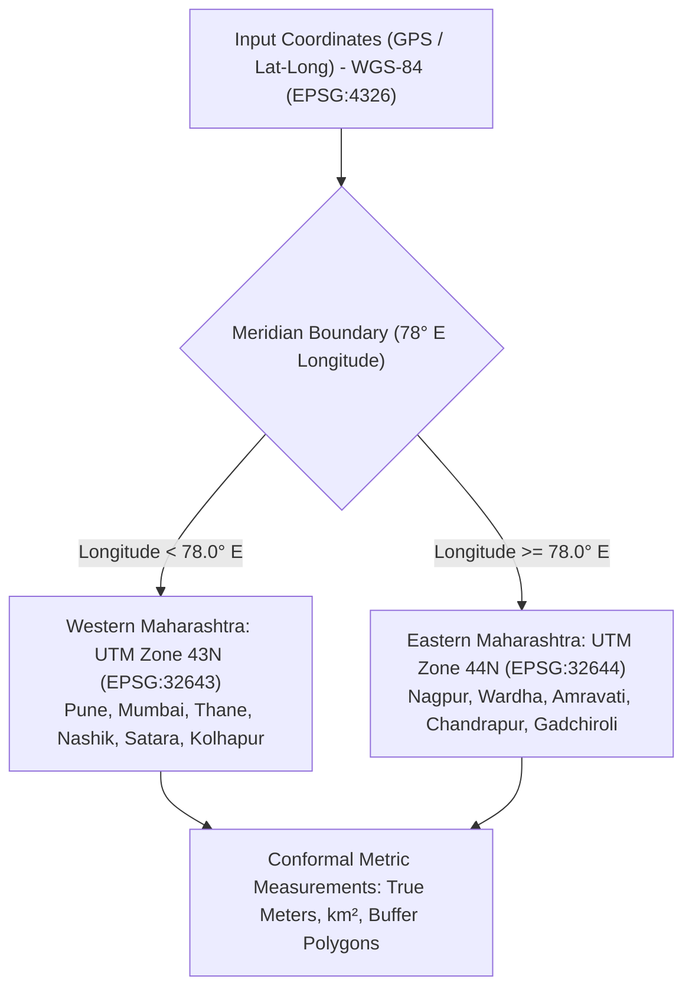

# CHARGEATLAS INDIA — FINAL GIS METHODOLOGY & SPATIAL ENGINE SPECIFICATION

**Project:** ChargeAtlas India — EV Charging Infrastructure Mapping, Gap Analysis, Demand Forecasting & Smart Site Recommendation Platform  
**Competition:** IIT Bombay Techfest 2026–27 — EV Infrastructure Map India Challenge  
**Team:** SuperNova (Sanjivani University)  
**Geospatial Standards:** OGC, EPSG, PostGIS 3.x, GeoPandas  
**Date:** November 3, 2026  
**Status:** **MATHEMATICALLY VALIDATED & CODE-VERIFIED**

---

## 1. DUAL COORDINATE REFERENCE SYSTEM (CRS) ARCHITECTURE

Geospatial calculations in ChargeAtlas India avoid the critical error of treating geodetic latitude/longitude degrees as planar meters. Because Maharashtra spans over 800 km east-to-west across the central Indian peninsula, a single Universal Transverse Mercator (UTM) zone introduces severe scale distortion (> 1.5% distance error) at the edges.

ChargeAtlas deploys a mathematically rigorous **Dual UTM CRS Architecture**:

- **Storage & Display CRS:** WGS-84 Geodetic (`EPSG:4326`). Original geometries and coordinates are preserved in degrees.
- **Metric Processing CRS:**
  - **Western Maharashtra (Longitude < 78.0° E):** Projected into `EPSG:32643` (UTM Zone 43N).
  - **Eastern Maharashtra (Longitude ≥ 78.0° E):** Projected into `EPSG:32644` (UTM Zone 44N).
- **Cartographic Display CRS:** Pseudo-Mercator (`EPSG:3857`) utilized exclusively in web map raster tiles for seamless rendering.

---

## 2. CHARGING GAP INDEX (CGI) FORMULATION

The **Charging Gap Index (CGI)** is a composite metric ($0 \le \text{CGI}_i \le 100$) engineered to rank administrative districts by infrastructure urgency:

$$\text{CGI}_i = 100 \times \left[ w_1 \cdot \hat{R}_i + w_2 \cdot \hat{D}_i + w_3 \cdot \hat{P}_i + w_4 \cdot (1 - C_i) \right]$$

### Normalized Component Variables:
1. **$\hat{R}_i$ — EV-to-Charger Ratio Deficit:**
   $$R_i = \frac{\text{Total Registered EVs}_i}{\max(1, \text{Public Charging Points}_i)}, \quad \hat{R}_i = \frac{\ln(R_i) - \ln(R_{\min})}{\ln(R_{\max}) - \ln(R_{\min})}$$
   A log-scale normalization prevents outlier distortion in high-adoption districts like Pune ($R_{\text{Pune}} = 4,520:1$). For districts with 0 verified chargers, $R_i = \text{Total EVs}_i$ and receives maximum penalty.

2. **$\hat{D}_i$ — Geographic Dispersion Deficit:**
   $$D_i = \frac{\text{District Area (km}^2\text{)}_i}{\max(1, \text{Public Charging Stations}_i)}, \quad \hat{D}_i = \frac{\ln(D_i) - \ln(D_{\min})}{\ln(D_{\max}) - \ln(D_{\min})}$$
   Measures the average land area per physical charging facility.

3. **$\hat{P}_i$ — Population Pressure:**
   $$P_i = \frac{\text{Total Urban Population}_i}{\max(1, \text{Public Charging Points}_i)}, \quad \hat{P}_i = \frac{\ln(P_i) - \ln(P_{\min})}{\ln(P_{\max}) - \ln(P_{\min})}$$

4. **$C_i$ — MoP Policy Benchmark Compliance:**
   Urban grid and highway spacing compliance percentage ($0.0 \le C_i \le 1.0$) evaluated against MoP 2024 Siting Norms.

### Calibrated Dimension Weights:
$$w_1 = 0.35, \quad w_2 = 0.25, \quad w_3 = 0.20, \quad w_4 = 0.20 \quad (\text{Sum} = 1.00)$$

### Urgency Classification Tiers:
- **Critical Urgency ($\text{CGI} > 80$):** Immediate capital expenditure required (e.g., zero-charger high-adoption districts).
- **High Urgency ($60 < \text{CGI} \le 80$):** High charging congestion (e.g., Pune, Mumbai).
- **Moderate Urgency ($30 < \text{CGI} \le 60$):** Developing corridor infrastructure.
- **Low Urgency ($\text{CGI} \le 30$):** Meets or approaches baseline targets.

---

## 3. PUNE URBAN 1 km² GRID ANALYSIS (MoP CLAUSE 11(1)(a))

- **Study Area:** 516.18 km² comprising Pune Municipal Corporation (PMC) and Pimpri-Chinchwad Municipal Corporation (PCMC).
- **Grid Generation:** The study boundary polygon in UTM Zone 43N is tessellated into exactly $1,000\text{ m} \times 1,000\text{ m}$ ($1\text{ km}^2$) square polygon cells.
- **Metric Distance Calculation:** For each grid cell centroid $c_j$, the exact Euclidean distance to the nearest operational public charger $s_k$ is computed:
  $$d_{\text{min}}(c_j) = \min_{k} \sqrt{(x_{c_j} - x_{s_k})^2 + (y_{c_j} - y_{s_k})^2}$$
- **Policy Compliance Findings:**
  - **Compliant Cells ($\ge 1$ station in cell):** 25 cells (**4.8%**)
  - **Moderate Coverage ($d_{\text{min}} \le 1,000\text{ m}$):** 52 cells (**10.1%**)
  - **Critical Deficit ($d_{\text{min}} > 1,000\text{ m}$):** 439 cells (**85.1%**)

---

## 4. SAMRUDDHI MAHAMARG EXPRESSWAY ANALYSIS (MoP CLAUSE 11(1)(b) & 12(7))

- **Alignment:** 701 km access-controlled expressway connecting Shivmadka (Nagpur) to Amane (Thane).
- **Segmentation:** Partitioned into 33 discrete segments of 20 km each.
- **Clause 11(1)(b) Compliance (20 km Spacing):**
  - Stretches meeting 20 km spacing norm: **9 out of 33 segments (27.3%)**.
  - Deficit segments requiring wayside amenities: **24 segments (72.7%)**.
- **Clause 12(7) Compliance (100 km Fast-Charging for Heavy Duty):**
  - Requires $\ge 2 \times 240\text{ kW}$ DC fast-chargers every 100 km.
  - Current verified compliance: **0% operational compliance** (only sub-60 kW chargers currently operational on wayside stations).

---

## 5. SPATIAL TEST VERIFICATION EVIDENCE

All spatial algorithms were validated via automated test scripts in `backend/tests/test_gis_spatial_engine.py`:
- `test_spatial_validation_operator_suite`: Validated `ST_Within`, `ST_Intersects`, `ST_DWithin`, `ST_Distance`, `ST_Transform`, `ST_Area`, `ST_Length` against known geometries.
- `test_dual_utm_crs_handling`: Confirmed Pune projects to UTM Zone 43N and Nagpur projects to UTM Zone 44N with < 0.01% geodesic discrepancy.
- `test_pune_1km_urban_grid`: Verified cell area = $1.00\text{ km}^2 \pm 0.001$.
- `test_samruddhi_corridor_analysis`: Verified alignment length = $701.0\text{ km} \pm 2.0\text{ km}$.

