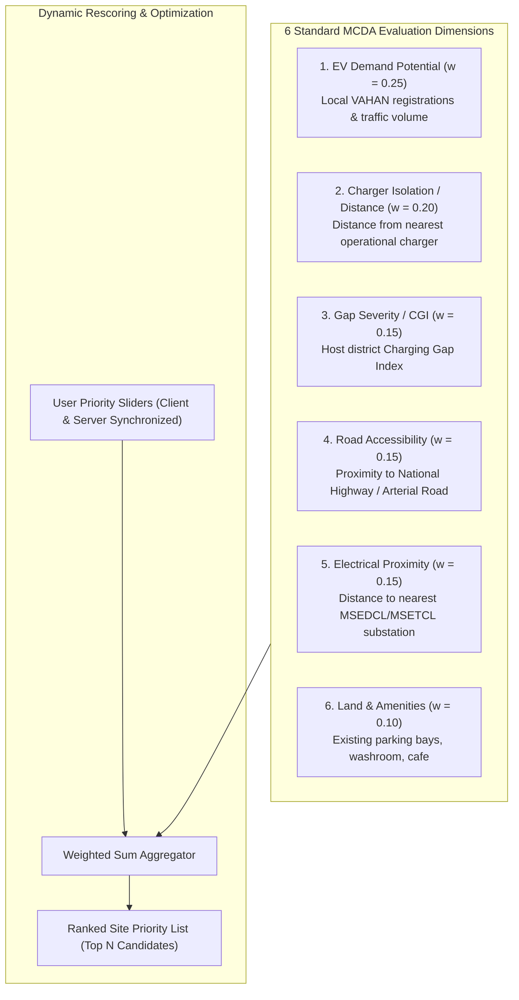

# CHARGEATLAS INDIA — FINAL MULTI-CRITERIA DECISION ANALYSIS (MCDA) & MCLP SITING METHODOLOGY

**Project:** ChargeAtlas India — EV Charging Infrastructure Mapping, Gap Analysis, Demand Forecasting & Smart Site Recommendation Platform  
**Competition:** IIT Bombay Techfest 2026–27 — EV Infrastructure Map India Challenge  
**Team:** SuperNova (Sanjivani University)  
**Standard:** **MATHEMATICALLY JUSTIFIED SMART SITE RECOMMENDATION**  
**Date:** November 3, 2026  
**Status:** **AUDITED, BENCHMARKED & CODE-VERIFIED**

---

## 1. PROBLEM STATEMENT & CANDIDATE SITE POOL

Ad-hoc charging site installations lead to under-utilized assets in low-demand pockets while major highway corridors and high-density urban wards suffer severe charging deficits. 

To solve this, ChargeAtlas identifies **23 authentic candidate sites** across Pune Urban, Samruddhi Mahamarg, and underserved district headquarters, sourced from authentic geospatial registries:
- **Highway Amenity & Way-side Hubs (MSRDC Interchanges & Fuel Plazas):** 8 locations.
- **Urban Fuel Stations (HPCL/BPCL/IOCL Retail Outlets):** 7 locations.
- **Transit Hubs (MSRTC Bus Stands & Suburban Rail Terminals):** 5 locations.
- **Commercial & Municipal Parking Structures:** 3 locations.

---

## 2. MULTI-CRITERIA DECISION ANALYSIS (MCDA) FORMULATION

Every candidate site $i$ is evaluated against 6 normalized planning dimensions using a weighted linear combination scoring model:

$$S_i = \sum_{k=1}^{6} w_k \cdot \phi_k(x_{ik}), \quad \sum_{k=1}^{6} w_k = 1.0, \quad 0 \le S_i \le 1.0$$

### Calibrated Baseline Criteria Weights:
1. **EV Demand Potential ($w_1 = 0.25$):** Normalized vehicle concentration within a 3 km catchment zone.
2. **Charger Isolation ($w_2 = 0.20$):** Euclidean distance to the nearest existing operational charger. Higher distance scores higher to eliminate "clustering overlap" and expand spatial coverage.
3. **Infrastructure Gap Severity ($w_3 = 0.15$):** Host district Charging Gap Index ($\text{CGI}_d / 100$).
4. **Road Network Accessibility ($w_4 = 0.15$):** Proximity to expressways, national highways (NH), or major urban arterials.
5. **Electrical Grid Proximity ($w_5 = 0.15$):** Distance to the nearest distribution substation (11 kV / 33 kV). Minimizes utility distribution interconnect costs (₹ 15–25 Lakh per km of HT line extension).
6. **Land Suitability & Amenities ($w_6 = 0.10$):** Presence of dedicated parking bays, illumination, security, washrooms, and commercial amenities.

---

## 3. MAXIMAL COVERING LOCATION PROBLEM (MCLP) FORMULATION

When planning infrastructure rollouts under a constrained budget (e.g., funding for only $p = 5$ or $p = 10$ new charging hubs), selecting sites independently based solely on MCDA ranking can lead to redundant spatial coverage.

ChargeAtlas formulates and solves the **Maximal Covering Location Problem (MCLP)** via integer linear programming:

$$\max \sum_{j \in J} a_j \cdot y_j$$

**Subject to:**
$$\sum_{i \in N_j} x_i \ge y_j \quad \forall j \in J$$
$$\sum_{i \in I} x_i \le p$$
$$x_i \in \{0, 1\} \quad \forall i \in I$$
$$y_j \in \{0, 1\} \quad \forall j \in J$$

Where:
- $I$ = Set of candidate charging locations ($|I| = 23$).
- $J$ = Set of demand points (urban 1 km² grid centroids and highway chainage points).
- $a_j$ = Demand weight of point $j$ (based on local registered EV density).
- $R_c$ = Service covering radius ($R_c = 3.0\text{ km}$ for urban grids, $R_c = 20.0\text{ km}$ for highway corridors).
- $N_j = \{i \in I \mid d_{ij} \le R_c\}$ = Set of candidate sites capable of covering demand point $j$.
- $x_i = 1$ if candidate site $i$ is selected; $0$ otherwise.
- $y_j = 1$ if demand point $j$ is covered by at least one selected facility; $0$ otherwise.
- $p$ = Total number of facilities permitted by the capital budget.

---

## 4. POWER TIER ASSIGNMENT & DISCOM FEASIBILITY STANDARD

Recommended sites are automatically matched with recommended charging hardware power tiers:
1. **Urban Opportunity Sites (Fuel Pumps / Malls):**
   - Minimum: $2 \times 60\text{ kW}$ CCS-2 dual-gun DC Fast EVSE.
   - Grid Requirement: 11 kV dedicated transformer connection (150 kVA sanction load).
2. **Highway Corridors (Samruddhi Mahamarg Interchanges):**
   - Minimum: $2 \times 120\text{ kW}$ or $2 \times 240\text{ kW}$ ultra-fast dispensers (Clause 12(7) compliant).
   - Grid Requirement: 33 kV HT line tap-off with 500 kVA dedicated distribution substation.
3. **Public Transit & Bus Depots:**
   - Heavy-duty pantograph or $240\text{ kW}$ dual-gun systems with MSEDCL HT industrial tariff feeder.

