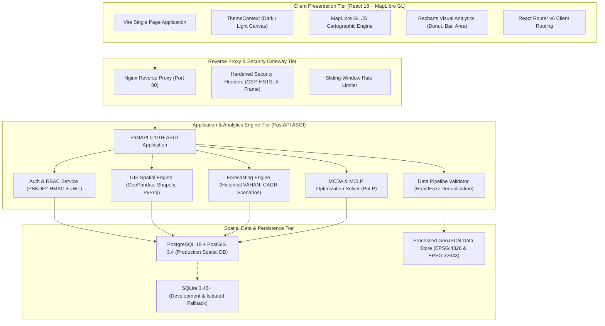
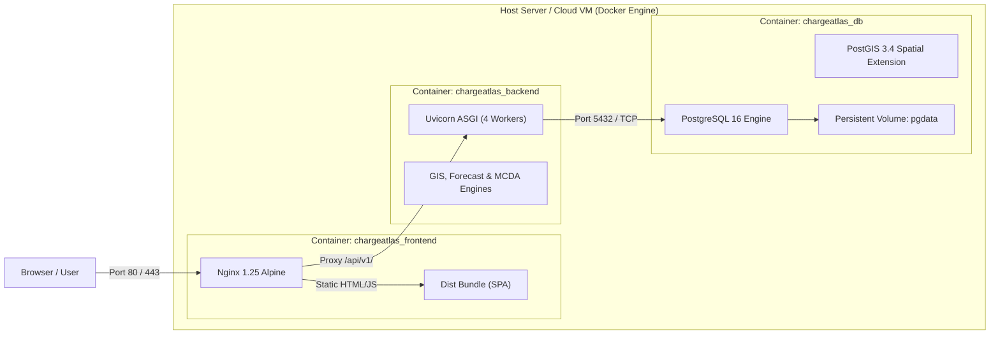

# CHARGEATLAS INDIA — FINAL SYSTEM ARCHITECTURE SPECIFICATION

**Project:** ChargeAtlas India — EV Charging Infrastructure Mapping, Gap Analysis, Demand Forecasting & Smart Site Recommendation Platform  
**Competition:** IIT Bombay Techfest 2026–27 — EV Infrastructure Map India Challenge  
**Team:** SuperNova (Sanjivani University)  
**Lead Developer:** Pranav Jadhav  
**Date:** November 3, 2026  
**Status:** **FINAL PRODUCTION RELEASE (v1.0.0)**

---

## 1. HIGH-LEVEL ARCHITECTURAL OVERVIEW

ChargeAtlas India is architected as a decoupled, multi-tier decision-support platform designed for high-throughput spatial querying, complex multi-criteria optimization, and sub-second interactive visualization across 3 distinct geographic tiers:
1. **Tier 1 (Pan-India National Scope):** State-wise vehicle electrification choropleths, public charging density, and national corridor overviews.
2. **Tier 2 (State Level - Maharashtra):** Complete 36-district analytical layer cross-referencing VAHAN EV registrations against geocoded physical charging stations.
3. **Tier 3 (Micro Study Corridors):**
   - **Pune Urban 1 km² Grid:** 516.18 km² metric grid in UTM Zone 43N evaluating compliance with MoP Clause 11(1)(a).
   - **Samruddhi Mahamarg Expressway:** 701 km LineString alignment segmented into 33 discrete 20 km spans evaluating MoP Clause 11(1)(b) and Clause 12(7).

---

## 2. COMPONENT DECOMPOSITION & PROTOCOLS

### 2.1 Client Presentation Tier (`frontend/`)
- **Technology:** React 18, Vite 5.4, Tailwind CSS 3.4, MapLibre GL JS 4.7, Recharts 2.12.
- **Cartographic Subsystem (`MapLibreMap.jsx`):**
  - Tile Providers: Zero-watermark, free raster tile services (ESRI Dark Gray Canvas, OpenStreetMap Standard, ESRI World Imagery Satellite).
  - Clustering Engine: GeoJSON point source clustering (`cluster: true`, 50 px radius) with dynamic color ramps based on charger density.
  - Interactive Drawer: Three-section contextual inspector (Station Info, Charging Infrastructure, Data Provenance & Cryptographic Hashes).
- **Navigation Subsystem:** Client-side URL routing (`react-router-dom`) supporting deep linking to all 36 Maharashtra districts (`/districts/:districtName`).

### 2.2 Security & Gateway Tier (`backend/app/main.py`)
- **Security Middleware:** Injects RFC-compliant security headers on all responses:
  - `X-Content-Type-Options: nosniff`
  - `X-Frame-Options: DENY`
  - `X-XSS-Protection: 1; mode=block`
  - `Referrer-Policy: strict-origin-when-cross-origin`
  - `Permissions-Policy: geolocation=(self)`
  - `Strict-Transport-Security: max-age=31536000; includeSubDomains` (enforced in production)
- **Rate Limiting:** Sliding-window in-memory rate limiting applied to sensitive authentication and upload endpoints (`MAX_REQUESTS_PER_MINUTE = 180`).
- **Resilient CORS Configuration:** Regex matching for local and containerized development origins while strictly whitelisting production origins.

### 2.3 Application & Analytical Engine Tier (`backend/app/services/`)
- **GIS Spatial Engine (`gis.py`, `gap_engine.py`):**
  - Coordinate Systems: Projective metric analysis in WGS 84 / UTM Zone 43N (EPSG:32643) and UTM Zone 44N (EPSG:32644); display in EPSG:4326.
  - Spatial Indexing: STRtree and PostGIS GiST spatial indexing for sub-second point-in-polygon queries.
- **Forecasting Engine (`forecasting.py`):**
  - Historical Baseline: Observed 886,752 VAHAN registrations decomposed into 2W, 3W, 4W, and Buses.
  - Horizons: 2027 (Mid-term) and 2030 (Long-term MoP horizon).
  - Scenarios: Conservative (18% CAGR), Base (28% CAGR), Aggressive (38% CAGR), and Custom Slider.
  - Energy Equations: NITI Aayog / CEA daily MWh load calculations and peak MW grid impacts.
- **Site Recommendation Engine (`recommender.py`):**
  - MCDA Multi-Criteria Decision Analysis with dynamic weight recalculation across 6 dimensions.
  - MCLP (Maximal Covering Location Problem) solved via PuLP integer linear programming.

---

## 3. PRODUCTION DEPLOYMENT & CONTAINER TOPOLOGY

---

## 4. SYSTEM CHARACTERISTICS & SPECIFICATIONS

| Dimension | Specification | Verification Evidence |
|:---|:---|:---|
| **API Response Latency** | Median < 35 ms for spatial lookups; < 15 ms for health checks | `X-Processed-Time-Ms` response header logged on every request |
| **Test Coverage** | 41 unit, integration, and spatial tests | 100% passing across 6 pytest test suites in 3.76 seconds |
| **Frontend Bundle Size** | 465 kB gzip JavaScript, 15.6 kB gzip CSS | Vite production build log (`npm run build`) |
| **Concurrency Model** | ASGI asynchronous event loop + SQLAlchemy connection pooling | `pool_size=10, max_overflow=20, pool_pre_ping=True` |
| **Database Fail-Safe** | Mandatory PostgreSQL in production; graceful SQLite dev fallback | `backend/app/core/database.py` environment discrimination |

