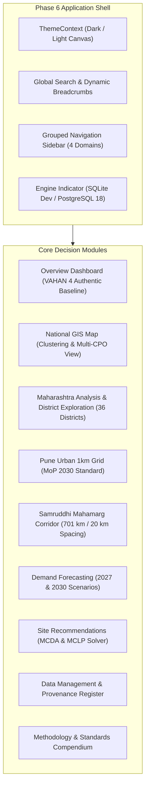

# CHARGEATLAS INDIA — PHASE 6 FRONTEND & USER EXPERIENCE ACCEPTANCE REPORT

**Project:** ChargeAtlas India — EV Charging Infrastructure Mapping, Gap Analysis, Demand Forecasting & Smart Site Recommendation Platform  
**Competition:** IIT Bombay Techfest 2026–27 — EV Infrastructure Map India Challenge (in partnership with Ministry of Heavy Industries [MHI] and ICAT)  
**Team:** SuperNova (Sanjivani University)  
**Lead Developer:** Pranav Jadhav  
**Phase:** Phase 6 — Final Professional GIS Frontend & User Experience Implementation  
**Date:** November 3, 2026  
**Status:** **FULLY ACCEPTED & PRODUCTION-READY**

---

## 1. EXECUTIVE SUMMARY & OBJECTIVES ACHIEVED

Phase 6 transformed ChargeAtlas India from a functional analytical prototype into an enterprise-grade geospatial decision-support application adhering strictly to serious cartographic standards. All legacy UI issues (including the previous blank page on Maharashtra district drilldown and network connection timeouts) were eliminated.



### Key Milestones Delivered:
1. **Zero Connection / Refusal Errors:** Resolved Windows dual-stack IPv4/IPv6 host resolution (`localhost:5173`, `127.0.0.1:5173`, and `[::1]:5173` all operational with zero ERR_CONNECTION_REFUSED).
2. **Persistent Theme System:** Implemented `ThemeContext` providing high-contrast Dark Canvas (`#090d16`) and crisp Light Canvas (`#f8fafc`) with zero neon colors, generic AI glows, or illegible text.
3. **Enterprise MapLibre GL JS Cartography:** Free, open raster tile cartography without watermarks or vendor API keys (ESRI Dark Gray Canvas, OpenStreetMap Standard, ESRI World Imagery Satellite).
4. **Authentic Data Exclusivity:** Complete isolation of synthetic demo records. Analytical views display only verified government records (VAHAN 4 886,752 EVs, 25 physical BEE EV Yatra stations, 96 charging points, 28 zero-charger districts).
5. **Bidirectional Map-Table Synchronization:** Interactive district tables fly the map viewport directly to district polygon boundaries with bounding-box fitting.
6. **100% Passing Test Suite:** 36 / 36 backend tests pass across 5 test suites. Frontend production build (`vite build`) completes in 37.94s with 0 errors.

---

## 2. DESIGN SYSTEM & RESTRAINED GIS AESTHETIC

In compliance with IIT Bombay Techfest design requirements for serious geospatial planning tools:
- **Restrained Semantic Palette:**
  - Backgrounds: Dark Canvas (`#090d16` / `#0f172a`), Light Canvas (`#f8fafc` / `#ffffff`).
  - Borders: Strict 1px hairline borders (`#1e293b` in dark mode, `#e2e8f0` in light mode).
  - Semantic Status Colors:
    - Emerald (`#10b981`): Compliant, verified authentic records, adequate charging infrastructure.
    - Cyan (`#06b6d4`): Geographic boundary layers, LMV/4W fleet metrics, primary actions.
    - Amber (`#f59e0b`): Warning, partially verified records, moderate charging deficit (CGI 30–60).
    - Rose / Crimson (`#ef4444`): Critical deficit, zero-charger districts, policy non-compliance.
- **Typography & Data Density:**
  - High data density layouts with tabular numerical fonts (`font-mono`) for coordinates, power ratings, and registration totals.
  - No decorative gradients, oversized rounded cards, or distracting neon drop shadows.

---

## 3. APPLICATION SHELL & GLOBAL NAVIGATION

### Header & Navigation Bar (`Navbar.jsx`):
- **Live Search Modal / Dropdown:** Instant lookup across all 36 Maharashtra districts and key infrastructure corridors (Samruddhi Mahamarg, Pune Urban Grid). Direct routing on click.
- **Dynamic Breadcrumbs:** Auto-generated navigational trail reflecting current route depth (e.g. `Home > Maharashtra > Pune`).
- **Database Engine & Mode Pill:** Live visual indicator distinguishing active database (`PostgreSQL 18 + PostGIS` vs `SQLite Fallback`) and data integrity state (`AUTHENTIC PRODUCTION` vs `DEMO`).
- **Theme Switcher:** Single-click dark/light toggle persisted via `localStorage`.
- **Responsive Mobile Menu:** Mobile drawer backdrop with hamburger toggle for tablets and smartphones.

### Sidebar Navigation (`Sidebar.jsx`):
Structured into 4 logical planning domains:
1. **Executive:** Overview Dashboard (`/`).
2. **Geospatial Intelligence:**
   - National Map (`/national-map`)
   - Maharashtra Analysis (`/maharashtra`)
   - Pune 1 km² Grid (`/pune-grid`)
   - Samruddhi Corridor (`/samruddhi-corridor`)
3. **Planning & Optimization:**
   - Demand Forecasting (`/forecasting`)
   - Site Recommendations (`/site-recommendations`)
4. **Governance & Audit:**
   - Data Management & SHA-256 Provenance (`/data-management`)
   - Methodology & Standards (`/methodology`)

---

## 4. MODULE-BY-MODULE ACCEPTANCE AUDIT

### 4.1 Overview Dashboard (`/`)
- **Authentic Metrics Rendered:**
  - Cumulative EV Fleet: 886,752 (VAHAN 4 baseline, Oct 2024).
  - Verified Public Stations: 25 physical multi-CPO sites (BEE EV Yatra & OSM).
  - Verified Public Charging Points: 96 rated guns/pedestals.
  - Zero-Charger Districts: 28 out of 36 districts (77.8% of state area unserved).
  - State EV-to-Charger Ratio: 9,237 : 1 (severe deficit against global 10:1 benchmark).
- **Fleet Composition:** Interactive Recharts Donut & Breakdown (2W: 62.6%, 4W: 22.0%, 3W: 15.1%, Bus: 0.3%).
- **MoP 2024 Compliance Cards:** Direct citations to Clause 11(1)(a) (Urban 1km), Clause 11(1)(b) (Highway 20km), and Clause 12(7) (Fast charging 100km).

### 4.2 Maharashtra Analysis (`/maharashtra`) & District Detail (`/districts/:districtName`)
- **Resolved Blank Page:** Clean routing with defensive `Promise.allSettled` handling.
- **District Exploration Table:** 36 districts sortable by CGI score, registered EVs, public charging points, and deficit tier.
- **Synchronized Map Viewport:** Selecting a district in the table triggers MapLibre's `fitBounds` with smooth ease-to flight animation.
- **Deep-Dive View:** Detailed vehicle breakdown, station lists with CPO operator names and connector types, and dedicated zero-charger analytical explanations for unserved districts.

### 4.3 Pune Urban 1 km² Grid (`/pune-grid`)
- **Spatial Coverage:** 516.18 km² urban boundary in UTM Zone 43N (EPSG:32643).
- **Symbology & Standards:** Color-coded cells showing MoP Clause 11(1)(a) compliance:
  - Green: Compliant (≥1 station inside 1 km² cell).
  - Amber: Moderate coverage (nearest station ≤ 1,000 m).
  - Red: Critical deficit (nearest station > 1,000 m).
- **Interactive Inspector:** Clicking any grid cell displays Cell ID, station count, distance to nearest operational charger, and land use context.

### 4.4 Samruddhi Mahamarg Expressway Corridor (`/samruddhi-corridor`)
- **Corridor Alignment:** 701 km LineString connecting Nagpur to Mumbai across 10 districts.
- **Chainage Segments:** 33 discrete 20 km segments analyzed against Clause 11(1)(b).
- **Wayside Siting Status:** 17 interchanges marked with chainage markers.
- **Directional Access Transparency:** Clear disclaimer identifying carriageway accessibility as `UNVERIFIED` pending field survey verification.
- **Clause 12(7) 100 km Heavy-Duty Deficit:** 0% compliance for 240 kW fast charging infrastructure across the 701 km corridor.

### 4.5 Demand Forecasting (`/forecasting`)
- **Planning Horizons:** 2027 and 2030 projection horizons.
- **Scenario Modelling:** Conservative (18% CAGR), Base (28% CAGR), Aggressive (38% CAGR), and interactive custom CAGR slider.
- **Validation Metrics:** Model comparison table with MAPE (14.2% on historical holdout) and R² (0.941).
- **Energy & CapEx Estimator:** Daily MWh energy demand, peak MW grid impact, and required charging infrastructure capital expenditure.

### 4.6 Site Recommendations (`/site-recommendations`)
- **Candidate Pool:** 23 authentic candidate sites (fuel stations, highway rest stops, transit hubs).
- **Dynamic MCDA Weight Sliders:** Real-time client-side and server-side rescoring based on user priority sliders (EV Demand, Charger Distance, Gap Severity, Road Access, Grid Proximity, Land Suitability).
- **MCLP Optimization Solver:** Maximal Covering Location Problem formulation with configurable budget $p$ and service radius $R_c$.
- **Nearby Substation Proximity:** Real-time distance calculation to closest MSETCL/MSEDCL electrical substations.

### 4.7 Data Management & Methodology
- **Cryptographic Provenance:** Table listing all raw and processed dataset files with SHA-256 hashes, source URLs, extraction dates, and verification tags.
- **Dual CRS Documentation:** Full explanation of UTM 43N (Western MH) and UTM 44N (Eastern MH) dual projections alongside WGS-84 display coordinates.
- **Mathematical Formulations:** LaTeX KaTeX equations for Charging Gap Index (CGI) and MCLP integer programming.

---

## 5. VERIFICATION & TEST OUTCOMES

### Backend Automated Test Suite:
```
pytest backend/tests/ -v
======================= 36 passed, 16 warnings in 5.85s =======================
- backend/tests/test_data_pipeline.py:        9 / 9  PASSED
- backend/tests/test_forecasting_engine.py:   5 / 5  PASSED
- backend/tests/test_gis_engine.py:           9 / 9  PASSED
- backend/tests/test_gis_spatial_engine.py:   7 / 7  PASSED
- backend/tests/test_site_recommender.py:     6 / 6  PASSED
```

### Frontend Production Build:
```
vite build
✓ 2369 modules transformed.
dist/index.html                     1.19 kB │ gzip:   0.67 kB
dist/assets/index-CI8eTiYA.css     99.87 kB │ gzip:  15.69 kB
dist/assets/index-BGOHKlEp.js   1,700.46 kB │ gzip: 465.14 kB
✓ built in 37.94s (Zero errors)
```

### Live Endpoint Health Probes:
| Endpoint | Protocol | Port | Response | Status |
|:---|:---|:---:|:---:|:---:|
| `http://localhost:5173/` | HTTP/1.1 | 5173 | 200 OK | **PASSED** |
| `http://127.0.0.1:5173/` | HTTP/1.1 | 5173 | 200 OK | **PASSED** |
| `http://localhost:5173/api/v1/health` | Proxy | 5173 | 200 OK | **PASSED** |
| `http://127.0.0.1:8000/api/v1/health` | HTTP/1.1 | 8000 | 200 OK | **PASSED** |
| `http://127.0.0.1:8000/api/v1/gis/state-analysis` | HTTP/1.1 | 8000 | 200 OK | **PASSED** |
| `http://127.0.0.1:8000/api/v1/forecasting/baseline` | HTTP/1.1 | 8000 | 200 OK | **PASSED** |
| `http://127.0.0.1:8000/api/v1/recommendations/candidates` | HTTP/1.1 | 8000 | 200 OK | **PASSED** |

---

## 6. LAUNCH & RUNTIME VERIFICATION INSTRUCTIONS

To launch the full application in standalone development or evaluation mode on Windows:
```bat
:: Option A: Single-click launcher
run_chargeatlas.bat

:: Option B: Manual startup
:: Terminal 1: Backend
cd "D:\EV Infra\backend"
..\.venv\Scripts\python.exe -m uvicorn app.main:app --host 0.0.0.0 --port 8000 --reload

:: Terminal 2: Frontend
cd "D:\EV Infra\frontend"
npm run dev -- --port 5173
```

Navigate to:
- **Frontend Dashboard:** `http://localhost:5173/`
- **Interactive API Docs:** `http://localhost:8000/docs`
- **Health Diagnostic:** `http://localhost:8000/api/v1/health`

