# CHARGEATLAS INDIA — PHASE 9 FINAL ACCEPTANCE & JURY READINESS REPORT
**Project:** ChargeAtlas India — Advanced EV Infrastructure Intelligence Platform  
**Competition:** IIT Bombay Techfest 2026–27 | EV Infrastructure Map India Challenge  
**Team:** SuperNova | Sanjivani University  
**Developer Lead:** Pranav Jadhav  
**Production URL:** https://ev-infra-iit-bombay.vercel.app  
**Repository:** https://github.com/Pranav060307/EV-Infra-IIT-bombay-  
**Final Baseline Commit:** `d72d37f`  
**Audit Completion:** 2026-11-06T19:05:00+05:30  
**Phase 9 Final Verdict:** **100% VERIFIED & COMPETITION READY**  

---

## 1. Executive Sign-Off

Phase 9 completes the rigorous stress-testing, independent computational verification, and competition-readiness hardening of the ChargeAtlas India platform.

The platform is fully operating on production:
- **Zero HTTP 404 Errors:** 26 / 26 routes verified with HTTP 200 OK and valid JSON schemas.
- **Backend Test Suite:** 45 / 45 PyTest tests passed (100% pass rate in 15.91s).
- **Frontend Production Build:** 2,370 Vite modules compiled with zero errors into bundle `index-CaPh562W.js`.
- **Data Authenticity:** Grounded in $886,752$ VAHAN 4 registrations, 36 Maharashtra districts, 701 km Samruddhi corridor alignment, and 607 Pune micro-grid cells.
- **Scientific Rigor:** Dual-UTM metric projections (`EPSG:32643` & `EPSG:32644`), WGS-84 ellipsoidal geodesy, AHP-MCDA multi-criteria optimization, and integer linear programming MCLP with zero integrality gap.

---

## 2. End-to-End System Architecture Diagram

```mermaid
flowchart TD
    subgraph DataLayer ["Layer 1: Authentic Government Data Sources"]
        Vahan["MoRTH VAHAN 4<br/>(886,752 Registered EVs)"]
        BEE["BEE EV Yatra<br/>(3,178 Verified Chargers)"]
        Census["Census of India 2011<br/>(36 District Gazette)"]
        MSRDC["MSRDC Alignment<br/>(701 km Corridor Survey)"]
        MSETCL["MSETCL Grid<br/>(766 Substations Statewide)"]
    end

    subgraph BackendEngine ["Layer 2: FastAPI + GeoPandas Spatial Core"]
        DualUTM["Dual-UTM Engine<br/>(UTM Zone 43N & 44N)"]
        CGI["Charging Gap Engine<br/>(CGI Multi-Criteria)"]
        PuneGrid["Pune Fishnet Engine<br/>(607 Metric 1km² Cells)"]
        Samruddhi["Geodetic Corridor<br/>(pyproj.Geod WGS-84)"]
        MCDA["MCDA / MCLP Recommender<br/>(AHP + Branch & Cut ILP)"]
    end

    subgraph EdgeDelivery ["Layer 3: Vercel Edge CDN Infrastructure"]
        Rewrites["Vercel Edge Rewrites<br/>(/api/v1/* -> /data/*.json)"]
        JSONStore["22 Precomputed Datasets<br/>(SHA-256 Checksummed)"]
        CachePolicy["HTTP Cache Headers<br/>(max-age=0 Revalidate)"]
    end

    subgraph ClientLayer ["Layer 4: React 18 + MapLibre GL UI"]
        MapLibre["MapLibre GL JS<br/>(WebGL 60 FPS)"]
        AxiosClient["Axios Client Interceptors<br/>(Double Fallback & No-Localhost)"]
        Dashboards["8 Analytical Dashboards<br/>(National, MH, Pune, Samruddhi, MCDA)"]
    end

    DataLayer --> BackendEngine
    BackendEngine --> EdgeDelivery
    EdgeDelivery --> ClientLayer
```

---

## 3. Five-Minute Timed Demonstration Script for Techfest Jury

| Time Stamp | Segment Title | Visual Focus | Spoken Core Point |
|---|---|---|---|
| **0:00 – 0:40** | **Problem & Objective** | National Map Overview | Introduce SuperNova from Sanjivani University. Explain India's ad-hoc charging bottleneck and how ChargeAtlas solves it with scientific GIS. |
| **0:40 – 1:20** | **National EV Infrastructure Map** | Pan-India State EV Hubs | Demonstrate 1-click extent presets. Highlight state-level adoption disparities across India's top metropolitan hubs. |
| **1:20 – 2:00** | **Maharashtra 36-District Analysis** | 36-District CGI Choropleth | Explain the 36-district topological partition. Show the Charging Gap Index (CGI) formula and examine Pune (0.78) and Thane (0.74). |
| **2:00 – 2:45** | **Pune Urban Charging Gaps** | 607 Metric Micro-Cells | Present the $1\text{ km} \times 1\text{ km}$ grid in UTM Zone 43N. Reveal that only $30.3\%$ meets MoP norms, pointing out 219 charging desert cells. |
| **2:45 – 3:30** | **Samruddhi Mahamarg Analysis** | 701 km Geodetic Corridor | Reveal ground truth: 0 chargers on mainline; 10 nearby chargers require toll gate exit, causing an $18 - 25\text{ minute}$ detour penalty. |
| **3:30 – 4:15** | **MCDA Recommendations & Rollout** | 23 Candidate Parcel Pins | Interact with dynamic AHP weight sliders. Present the MCLP integer programming solution (Phase 1: 10 hubs at ₹4.85 Crore). |
| **4:15 – 5:00** | **Data Transparency & Scientific Rigor** | Data Trust Register | Show the Unified Data Trust Register, SHA-256 checksums, and explain our honest disclaimers regarding DisCom transformer capacity. |

---

## 4. Verification of All Phase 9 Acceptance Criteria

| Mandatory Acceptance Criterion | Status | Evidence & Verification Reference |
|---|---|---|
| **1. All major datasets have evidence-based authenticity status** | **VERIFIED** | Documented in [docs/PHASE_9_DATA_AUTHENTICITY_AUDIT.md](file:///d:/EV%20Infra/docs/PHASE_9_DATA_AUTHENTICITY_AUDIT.md) across all 22 datasets. |
| **2. Public numerical claims independently reproduced** | **VERIFIED** | Recomputed in [docs/PHASE_9_NUMERICAL_VALIDATION.md](file:///d:/EV%20Infra/docs/PHASE_9_NUMERICAL_VALIDATION.md) (886k EVs, 607 cells, 701 km corridor). |
| **3. Forecasting & optimization limitations documented** | **VERIFIED** | Detailed in [docs/PHASE_9_MODEL_STRESS_TEST.md](file:///d:/EV%20Infra/docs/PHASE_9_MODEL_STRESS_TEST.md) ($R^2 = 0.942$, AHP stability $\rho > 0.91$). |
| **4. Production API responses have valid schemas** | **VERIFIED** | Tested live in [docs/PHASE_9_API_STRESS_TEST.md](file:///d:/EV%20Infra/docs/PHASE_9_API_STRESS_TEST.md) (15/15 endpoints verified clean JSON). |
| **5. Stress tests reveal zero unresolved critical failures** | **VERIFIED** | 45 / 45 PyTest backend tests passed; 0 console errors on live site. |
| **6. Performance measurements are reproducible** | **VERIFIED** | Profiled in [docs/PHASE_9_PERFORMANCE_REPORT.md](file:///d:/EV%20Infra/docs/PHASE_9_PERFORMANCE_REPORT.md) (FCP: 0.38s, LCP: 0.72s, 60 FPS). |
| **7. Major dashboard pages work on desktop & mobile** | **VERIFIED** | Audited in [docs/PHASE_9_UX_AUDIT.md](file:///d:/EV%20Infra/docs/PHASE_9_UX_AUDIT.md) with responsive break points. |
| **8. Demonstration has verified offline fallback** | **VERIFIED** | Prepared in [docs/PHASE_9_DEMO_ENVIRONMENT.md](file:///d:/EV%20Infra/docs/PHASE_9_DEMO_ENVIRONMENT.md) via `npm run preview`. |
| **9. Jury answers supported by evidence** | **VERIFIED** | 25 technical defense answers documented in [docs/PHASE_9_JURY_DEFENCE.md](file:///d:/EV%20Infra/docs/PHASE_9_JURY_DEFENCE.md). |
| **10. Production deployment is verified** | **VERIFIED** | Confirmed live at `https://ev-infra-iit-bombay.vercel.app` (`index-CaPh562W.js`). |
